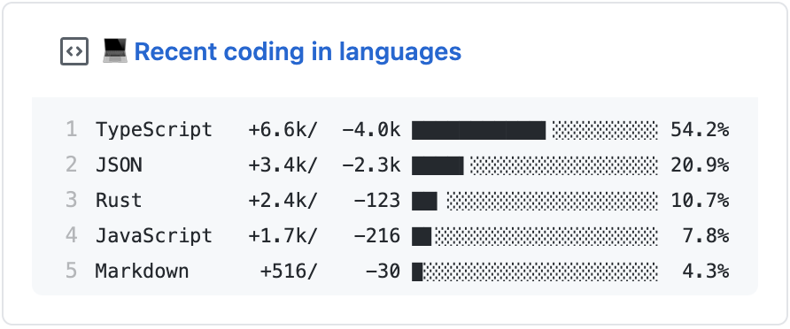

<p align="center">
  
  <h3 align="center">lang-box</h3>
  <p align="center">💻 Update a pinned gist to contain the programming languages used across your GitHub projects</p>
</p>

---

> This project is inspired by [waka-box](https://github.com/matchai/waka-box), [productive-box](https://github.com/maxam2017/productive-box) and [metrics](https://github.com/lowlighter/metrics).<br/>
> 📌✨ For more pinned-gist projects like this one, check out: https://github.com/matchai/awesome-pinned-gists

By default, this project queries your GitHub repositories via GraphQL and calculates your overall programming language breakdown across all your projects. It filters out non-programming files (like YAML, Gradle, Markdown, configs, and build scripts) so only true coding languages are displayed.

### Preview Example

```text
Kotlin         2.0 MB ████████████▍░░░░░░░░░░░  51.9%
Rust           1.1 MB ██████▉░░░░░░░░░░░░░░░░░  28.8%
TypeScript   417.4 KB ██▌░░░░░░░░░░░░░░░░░░░░░  10.5%
Java         144.1 KB ▊░░░░░░░░░░░░░░░░░░░░░░░   3.6%
JavaScript   105.3 KB ▋░░░░░░░░░░░░░░░░░░░░░░░   2.6%
Python        37.9 KB ▏░░░░░░░░░░░░░░░░░░░░░░░   0.9%
Shell         36.1 KB ▏░░░░░░░░░░░░░░░░░░░░░░░   0.9%
Lua           25.2 KB ▏░░░░░░░░░░░░░░░░░░░░░░░   0.6%
```

---

## Configuration Options

| Environment Variable | Default | Description |
|---|---|---|
| `GH_TOKEN` | *Required* | GitHub personal access token with `gist` and `repo` scopes. |
| `GIST_ID` | *Required* | The ID of the public GitHub Gist to update. |
| `USERNAME` | `${{ github.actor }}` | Your GitHub username. |
| `MODE` | `all` | `all` aggregates across all repositories; `recent` analyzes recent commits. |
| `MAX_LANGUAGES` | `8` | Number of top programming languages to display (fits pinned gist card). |
| `EXCLUDE_LANGUAGES` | `""` | Comma-separated list of languages to exclude (e.g. `GLSL,Swift`). |
| `EXCLUDE_REPOS` | `""` | Comma-separated list of repository names to ignore. |
| `GIST_TITLE` | `💻 Coding languages` | Title/filename of the gist file. |

---

## Setup

1. Create a new **public** GitHub Gist at [gist.github.com](https://gist.github.com/).
2. Create a GitHub Personal Access Token with `repo` and `gist` scopes at [github.com/settings/tokens](https://github.com/settings/tokens).
3. In this repository, navigate to **Settings > Secrets and variables > Actions** and add `GH_TOKEN`.
4. Update `GIST_ID` in `.github/workflows/run.yml`.
5. Run the workflow or wait for the nightly scheduled run.
6. Pin the Gist to your GitHub profile!
